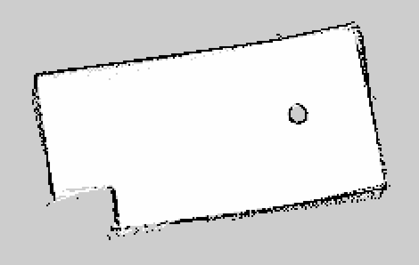

# TurtleBot3 State Estimation and Mapping (ROS 2)

ROS 2 packages for a TurtleBot3 that estimate its heading, build a map of its arena from LiDAR scans, and localize itself in that map. Built for CMU 16-280 Intelligent Robot Systems (Fall 2026) as a team, and tested on the real robot.



*Map of the test arena built from LiDAR scans by the occupancy grid mapping node (1 cm cells).*

## What's in here

| Part | What it does | Code |
|---|---|---|
| Yaw fusion | Integrates IMU gyro readings into a heading, pulls heading from wheel odometry, and blends the two with a complementary filter (tunable `alpha` parameter). The gyro is smooth but drifts and odometry doesn't drift but is noisy, so blending gives a better heading than either alone. | `src/tb3_yaw_fusion/` |
| ICP scan matching | Turns each LiDAR scan into a point cloud and aligns it to the previous scans with point-to-point ICP (KD-tree nearest neighbors, SVD for the best rotation and translation, stop when the error stops improving). Matched scans are merged into one growing cloud in RViz. | `src/icp_package/icp_package/scan_match.py`, `scan_merge.py` |
| Point-to-plane ICP | Offline version of ICP that uses surface normals (PCA over nearby points) so walls slide along each other instead of snapping to the wrong point. Runs on logged odometry and scan data, no ROS needed. | `src/icp_package/hw4_all/individual/point2plane.py` |
| Occupancy grid mapping | Builds a 2D map with the log-odds update. Each scan beam marks the cells it passes through as more likely free (Bresenham ray casting) and the cell it hits as more likely occupied. Publishes the map on `/map`. | `src/icp_package/icp_package/hw5_all/OGM_files/` |
| Particle filter localization (MCL) | Tracks 80 guesses of the robot's pose. Each guess moves with odometry plus noise, gets weighted by how well the live scan lines up with the saved map (likelihood field from a distance map), and the set is redrawn with systematic resampling. Supports both a manual starting pose from RViz and automatic anchoring once the particles converge. | `src/icp_package/icp_package/hw6_all/particle_filter_main.py` |

The course gave starter code with the ROS plumbing and marked sections to fill in. The algorithm parts above (ICP, the log-odds update and ray casting, the particle filter's motion, measurement and resampling steps, and the yaw fusion nodes) are the parts we implemented.

## Team

The work was split evenly across our three-person team: [@Ph1so](https://github.com/Ph1so), [@Christinetrr](https://github.com/Christinetrr) and [@diqiux](https://github.com/diqiux).

## Running it

Requires ROS 2 and a TurtleBot3 (or a bag file with `/scan`, `/imu` and `/odom`). This repo is the root of a colcon workspace.

```bash
colcon build
source install/setup.bash

# Heading estimation
ros2 run tb3_yaw_fusion imu_listener
ros2 run tb3_yaw_fusion odom_listener
ros2 run tb3_yaw_fusion complementary_yaw_fusion --ros-args -p alpha:=0.98

# ICP scan matching (press Enter in the terminal to capture a scan)
ros2 run icp_package scan_match

# Occupancy grid mapping
ros2 run icp_package ogm

# Particle filter localization against the saved map (map.pgm / map.yaml)
ros2 run icp_package particle
```

RViz configs for each part are next to the code (`icp_rviz.rviz`, `rviz_hw5.rviz`, `rviz_hw6.rviz`).

Note that the particle filter loads the map from a hard-coded path on the lab robot (`particle_filter_main.py`), so point it at `map.pgm` in this repo before running elsewhere.
